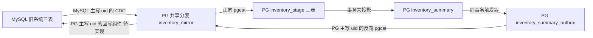

# 库存三表合并与反向拆分同步方案技术评审

评审基准日期：2026 年 11 月 18 日。适用对象：库存业务、数据库、数据平台和运维团队。

本方案按 uid 在旧 MySQL 与新 PostgreSQL 之间迁移主写权。同一个 uid 在一个时刻只有一个业务主写端：旧端主写时，MySQL 三表同步到 PG 分表，再合并到 PG summary；新端主写时，PG summary 拆回 PG 分表，再同步到 MySQL 三表，为故障切回准备数据。不同 uid 可以处于不同阶段，正反向同步任务可以同时运行。

目标架构允许复用 `inventory_mirror` 作为两个方向共享的旧结构 PG 表，不要求额外的 rollback schema。建议保留 outbox 适配旧模型。现有可执行基线仍使用独立 `inventory_rollback` 做隔离验证；按 uid 的写权门控、切换代次、mirror 身份接管和 PG 到 MySQL 的回写尚需补齐，不能直接改目标表名就宣称完成整个故障切换链路。

## 1 目标与范围

旧模型按 `(wh_id, upc, uid)` 存储三种库存数量。新模型按 `(warehouse_id, upc, owner_id)` 合并数量，并补充商品主数据、版本和 TBA 归属状态。

现有实现覆盖普通表的存量快照、INSERT、UPDATE、DELETE、事务末库存校验、反向三表投影和故障重试。MySQL binlog 由 Flink CDC 采集；pgcat 只连接 PostgreSQL。目标方案还包含 PG 分表到 MySQL 分表的独立回写组件，当前库存目录没有实现该组件。

本仓库的 `pgcat-yaml` 是参考上游设计的独立 Go 程序，本文结论以本地源码为准，不代表同名连接池产品或所有上游 pgcat 版本的能力。当前库存 YAML 使用默认 `identity.mode: columns`，由 `_sync_*` 列保存来源；仓库另有 sidecar 模式，但本案例没有切换到该模式。

## 2 数据流和组件分工



图为按 uid 主写权路由的目标设计。当前 YAML 反向目标仍是独立 rollback，图中 uid 门控和 PG 到 MySQL 回写不是现有配置已经具备的能力。新业务对 summary 的本地写入没有 origin，可以进入反向 pgcat；旧侧经正向 pgcat 投影到 summary 的事务不再反向转发，详见第 6 节。

| 组件 | 责任 | 不承担的责任 |
| --- | --- | --- |
| Flink CDC 和自定义 PG sink | MySQL 采集及落地 mirror | 不通过普通 route 自动完成三表有状态 JOIN |
| 正向 pgcat | mirror 到 stage 的一致快照、WAL 复制、字段路由和进度恢复 | 不计算库存三种数量的业务合并 |
| Stage 延迟触发器和 PL/pgSQL 函数 | 清洗业务键、查映射、读取三表最终状态、生成 summary | 不访问远程库、不提供跨库原子提交 |
| Summary 普通触发器 | 在同一事务中维护兼容旧模型的 outbox | 不确认下游是否已消费 |
| 反向 pgcat | PG 主写 uid 的 outbox 拆成共享 PG 三表；现有基线写独立 rollback | 不自动维护 uid 主写权，不反写 MySQL |
| PG 到 MySQL 回写组件 | 将 PG 主写 uid 的共享 PG 分表变更写回 MySQL，记录应用进度 | 当前目录待实现；必须接收反向 pgcat 产生的带 origin 变更 |
| uid 写权控制 | 持久记录主写侧和切换代次，约束业务写入与 CDC 应用 | 应用路由切换不能代替消费端对迟到事件的处理 |

这里使用的是 `CREATE FUNCTION ... LANGUAGE plpgsql`，由触发器调用，没有 `CREATE PROCEDURE`。现有复现环境使用同一 PostgreSQL 集群中的 mirror、merged、rollback 三个独立 database。目标设计可让反向输出复用 mirror；无需因为两个复制任务常驻就强制拆成两套 PG 分表。

## 3 表结构与字段语义

| Summary 字段 | 来源或规则 |
| --- | --- |
| `id` | 现货锚点表 `mem_user_inventory.id` |
| `warehouse_id` | `inventory_warehouse_map.legacy_wh_id → warehouse_id`，双向一一映射 |
| `upc` | 去除首尾空格，不得为空，长度不超过 255；已有 64 字符部署通过 SQL 27 扩容，保留完整 UPC |
| `owner_id` | 旧表 `uid`；新系统允许 NULL 表示 TBA |
| `on_hand_qty` | `mem_user_inventory.quantity` |
| `reserved_qty` | `mem_user_inventory_lock.quantity`；缺行按 0 |
| `hold_qty` | `mem_user_inventory_tracking.quantity`；缺行按 0 |
| `goods_name` 和 `goods_version` | `inventory_goods_map` 商品主数据 |
| `updated_at` | 三表 `last_update_time` 的最大值，单位为 Unix 秒；非正数使用当前时间 |

现货表是锚点。没有现货行时不生成 summary；锁定或暂扣快照先到可以暂存，锚点后到时重算。删除现货锚点会删除 summary 和对应 outbox，但不会自动删除孤儿 stage 明细，因此切换前必须检查孤儿。

业务约束为三种数量非负，且 `on_hand_qty >= reserved_qty + hold_qty`。TBA 的 reserved 和 hold 必须为 0。已确认库存按三元业务键唯一；TBA 通过部分唯一索引保证每个仓库和 UPC 至多一行。当前 `deleted` 仅允许 0，删除使用物理 DELETE。

反向拆分采用以下映射：

| 目标表 | quantity | id | 目标 upsert 键 |
| --- | --- | --- | --- |
| `mem_user_inventory` | `on_hand_qty` | `summary_id` | `(uid, wh_id, upc)` |
| `mem_user_inventory_lock` | `reserved_qty` | `summary_id` | `(upc, uid, wh_id)` |
| `mem_user_inventory_tracking` | `hold_qty` | `summary_id` | `(upc, uid, wh_id)` |

反向结果是旧结构的业务数量投影。锁定和暂扣表原始 id 并未保存在 summary 或 outbox 中，反向会统一使用 summary_id；原本缺失的锁定或暂扣行也会以数量 0 生成。依赖旧明细 id 的外键、审计或“无行和零行不同”的业务，必须补充原始三表身份和存在性信息后才能切回。

反向数量路由使用 `int32_exact`，把 numeric 的 `20.000000` 精确转换为整数 20，再写目标 integer。pgcat 的目标参数经 text 转目标类型，直接映射带小数位的 numeric 文本会报 `invalid input syntax for type integer`。本次为复现补充了该转换函数及测试，拒绝非零小数和 int4 溢出，不经过 float64，也不做四舍五入。部署须重新编译 pgcat；旧二进制不认识新函数。反向 YAML 已改变，已有任务不能复用旧 config hash，需版本化迁移。

## 4 事务与恢复保证

### 4.1 正向事务

同一个 mirror PostgreSQL 事务的三表变更，由 pgcat 在 merged PostgreSQL 的一个事务内应用。三个 stage 表均有 `DEFERRABLE INITIALLY DEFERRED` 的 AFTER ROW 约束触发器，事务提交前读取三表最终状态。PostgreSQL 的延迟约束触发器允许在事务末执行，或由 `SET CONSTRAINTS` 提前触发，见 [CREATE TRIGGER 官方说明](https://www.postgresql.org/docs/18/sql-createtrigger.html)。

例如旧值为 `10 / 3 / 2`，同事务先把现货改为 2，再将锁定和暂扣改为 0。逐条校验会看到不合法中间状态；延迟投影接受最终的 `2 / 0 / 0`。若最终状态仍不合法，stage、summary、outbox 和该次目标 checkpoint 一起回滚。

这个保证从 mirror 的 PostgreSQL 事务开始。它不能修复上游 Flink sink 拆散的 MySQL 事务。自定义 PG sink 必须提供同一 MySQL 事务跨表的目标事务保证，并通过多表更新和故障重启测试验证；普通批量 flush、时间间隔或 Flink checkpoint 配置本身不能证明这一点。

### 4.2 本地 outbox 事务

`inventory_summary` 的普通 AFTER 触发器在同一事务内更新 outbox。更新时先删除旧业务键对应行，再插入新状态；删除 summary 时删除 outbox。事务外消费者通过 WAL 只能消费已提交事务，但同一事务内仍可能出现多次投影和 DELETE 加 INSERT；当前实现没有按业务键合并触发器事件。

反向兼容检查失败会回滚业务 summary 写入，即使反向任务没有运行也一样。这是保留旧系统兼容窗口的明确业务约束，不是仅对 CDC 的约束。

### 4.3 跨库异步应用

pgcat 先 peek 源逻辑槽，在目标同一事务中提交业务 DML、`_pgcat_yaml.row_state` 与 checkpoint，随后才推进源 slot。失败时当前目标事务整体回滚，失败事务的 checkpoint 不前进。目标提交成功但源确认前退出时，重新启动按已保存的 checkpoint 避免再次产生业务效果。一个批次包含多个源事务时，较早成功事务可以已提交，保证单位是源事务。

反向一个源事务的三表写入在同一个 rollback database 中原子提交。没有横跨源库与目标库的全局 ACID 保证。目标不可用时，源库仍可提交有效库存事务，逻辑槽保留未消费 WAL；必须监控积压和磁盘。

## 5 Outbox 的决策

`inventory_summary_outbox` 保存每个已确认业务键的当前状态；没有消息序号、已发送标记、消费者 ack 或消费后清理流程。它适合作为普通逻辑发布表，不能按消息队列表定期清空。历史变更由 WAL 承载，也不应当作业务审计历史。

| 问题 | 当前 outbox 如何处理 | 删除 outbox 后需要补充什么 |
| --- | --- | --- |
| Summary 有生成列 | 发布无生成列普通表 | 改造 pgcat 源表校验和生成列处理，或修改业务 DDL |
| TBA 没有旧 uid | 触发器排除 owner_id 为 NULL 的行 | 实现稳定的非 NULL 过滤和状态迁移语义 |
| 旧仓库编号 | 同事务查询映射并存储 `legacy_wh_id` | 冗余旧编号或实现映射查询与历史事件一致性 |
| 时间类型 | `updated_at` 转 Unix 秒 `int4` | 增加确定性的时间转换 |
| 旧整数约束 | 已确认 id 为 1 至 2147483647，owner 为 0 至 2147483647；数量为整数且不超过此上限；owner=0 仍为 CONFIRMED | 明确兼容检查位于业务写入、复制端还是目标端 |
| 初始全量与增量一致 | 快照和 WAL 都读取相同的物理投影表 | 提供同样的快照、过滤、转换规则 |

当前 pgcat 校验普通源表、完整 publication 列、无 publication 行过滤、无生成列。源键必须非 NULL 且有唯一约束。直接发布 summary 不能只把 YAML 中的表名替换掉；普通 view 也不能直接替代这个被要求为普通表的源。

数量下界由 summary 的非负 CHECK 保证，outbox 自身的数量 CHECK 没有显式下界。应用应禁止绕过 summary 直接写 outbox。旧时间使用有符号 int4 秒，存在 2038 年上限；超过范围会在触发器中转换失败。小数库存、更大的已确认 id、数量或用户编号在兼容窗口内同样不能写入 summary。

若业务完全不需要反向兼容，可以通过版本化迁移一起移除 outbox、其同步触发器、publication 和反向任务；正向三表合并仍可保留。若仍需反向兼容，建议先保留当前适配表。

## 6 Origin 防环与按 uid 选择方向

Replication origin 给复制会话产生的事务标记来源，用于跟踪进度和识别回环；PostgreSQL 不会自动替业务选择转发策略，见 [Replication origins 官方说明](https://www.postgresql.org/docs/18/replication-origins.html)。本项目在 `runtime.go` 中只对 `origin == ""` 的增量事务生成业务目标写入，所有非空 origin 都不再转发，并非只拦截“来自对端”的特定名称。

| 场景 | outbox 是否变化 | 反向目标是否变化 |
| --- | --- | --- |
| 反向 `init snapshot: copy` | 读取现有状态 | 复制符合来源规则的现存行；本例 outbox 无 `_sync_*`，会被快照复制 |
| 反向初始化后 MySQL 经 mirror 和正向 pgcat 更新库存 | 会，继承正向事务 origin | 不变化，增量被跳过 |
| 反向初始化后新应用本地写 summary | 会，事务没有 origin | 写入三张旧结构表 |
| 正向删除锚点 | summary 和 outbox 被删除 | 对应旧结构行不会因该 origin 增量而删除 |

在共享 mirror 的目标设计中，MySQL 主写 uid 的变更已经到达 PG 分表，因此无需再走 summary 到 PG 分表的回环；此时跳过正向 origin 是符合预期的。PG 主写 uid 的本地 summary 变更则需要拆回 PG 分表，PG 分表上的正向 pgcat 应识别其 origin 并避免再次投影回 summary。

PG 分表到 MySQL 的回写组件必须允许消费这些带反向 pgcat origin 的变更，并且仅回写 PG 主写的 uid。若该组件也将所有非空 origin 事务一律丢弃，会直接切断所需的回写链路。

MySQL 接收到 PG 回写后产生的 binlog，重新被 Flink 捕获时不会自动携带 PostgreSQL replication origin。必须按 uid 写权、切换代次和已确认的事件边界过滤回声，或提供跨整个链路可保留的来源标识；不能只靠 PG 的 origin 实现 MySQL 与 PG 的端到端防环。对 DELETE 也需要同样的旧键与来源判断。

现有独立 rollback 实验仍保留表中行为：反向初始化后的正向 origin 增量不会更新独立 rollback。它证明当前引擎行为，不表示目标共享 mirror 架构必须支持这类级联。如果保留额外独立 rollback 并要求其持续全量一致，才需要另行设计向该副本的单向级联。

## 7 是否可以直接写 Mirror

可以，按 uid 保证一个业务主写端的场景允许反向输出复用 `inventory_mirror`。Flink 与 pgcat 是数据复制执行者；两个复制任务同时运行，不等于同一个 uid 有两个独立业务主写端。无需因为一个 uid 切到 PG 就停止所有 uid 的 Flink 作业。

需要控制的是切换边界的在途数据。例如 uid=1 在 MySQL 最后提交现货 10，CDC 尚未落 PG；随后该 uid 改由 PG 写成 11，并反向拆回 PG 分表。迟到的 MySQL 10 若仍被无条件应用，就可能覆盖 11。这个问题在没有同时业务双写时也会出现，需要该 uid 的 CDC 排空屏障、消费端写权门控和切换代次处理。

现有 mirror 行通常没有 `_sync_*` 标记。当前 columns 模式拒绝覆盖无来源既有行，并核对来源三元组；outbox 的来源身份是 merged/outbox，不等于原始三张 mirror 表，`adopt-unmarked-source` 也不是任意强制覆盖开关。将 YAML 目标表名从 rollback 改成 mirror 不能完成身份转换。将来换为 sidecar 也需要显式绑定迁移，不能自动恢复已丢失的三表 lineage。

本场景已有 mirror 是两向共享的业务基线，应按 uid 对齐来源身份、保留旧三表 id 和存在性，再开放反向写入。空表重建只是隔离实验的替代方法，不是要求清空生产 mirror。现有 YAML 的数量转换解决不了身份接管或 uid 主写权门控。

### 7.1 每个 uid 的主写状态

| 主写状态 | 业务请求写入 | 需要传播的变更 | 需要拦截或仅观察的事件 |
| --- | --- | --- | --- |
| MYSQL | MySQL 三表 | MySQL 到 PG 分表，再到 summary | 不将这些变更回写 MySQL |
| DRAINING | 暂停该 uid 的新写入 | 排空旧主截至切换边界的已提交事务 | 不提前开放新主 |
| PG | PG summary | summary 到 PG 分表，再到 MySQL 三表 | MySQL 回声和旧主迟到事件不得覆盖 PG |

建议持久记录 `uid`、`primary_side`、`epoch`、切换状态和每条链路的确认进度。epoch 表示该 uid 的写权代次，不能用本机时间代替。业务端和复制应用端都要核对有效写权；静态 YAML 等值路由或单纯查询当前主写侧，不能凭空识别历史事件属于哪个代次。实现需要持久事件边界或端到端代次信息。

本案例原有 `_sync_*` 标识用于数据来源归属，不等同于可切换的业务主写租约。主写权从 MySQL 变成 PG 时，同一个业务实体不应被当成另一个实体；切换需同时维护数据身份连续性与写权代次。

### 7.2 故障切回与数据恢复范围

计划切回时可以冻结该 uid 的 PG 写入，等待 PG 到分表再到 MySQL 的最后事务被确认应用，对账后增加 epoch 并开放 MySQL 写入。其他 uid 继续按自己的主写侧运行。

突然故障时，如果 PG 已提交但尚未复制到 MySQL，且无法从 PG 或 WAL 恢复，MySQL 只能接管已确认同步的前缀。异步链路本身不能承诺已返回成功的 PG 写入全部保留。评审需确定允许的数据恢复点目标 RPO；要求 RPO 为零时，需要跨端确认的业务成功语义，或能恢复全部已确认 PG 提交的高可用机制。切回到 MySQL 后还要阻止旧代次 PG 回写队列继续覆盖新的 MySQL 主写数据。

## 8 复现脚本和验收

### 8.1 环境要求

需要 PowerShell 7、Go 1.24 或以上、完整的 PostgreSQL 16 或以上服务端发行包，验证基线采用 PostgreSQL 18。服务端目录必须包含 `initdb`、`pg_ctl`、`postgres`、`psql`，只有客户端工具不足以启动实验。Linux 运行 initdb 时使用普通用户。Go 首次构建需要可访问依赖代理，或已有模块缓存。

在仓库根目录执行：

```powershell
# 便携式服务端在本仓库 tmp/toolchain/postgresql18-server/bin 时自动识别。
# 否则显式指定已安装的完整 PostgreSQL bin 目录。
pwsh -NoProfile -File ./inventory-sync/review/Run-ReviewLab.ps1 `
  -PgBin 'C:/PostgreSQL/18/bin' -Port 56489
```

脚本每次创建 `tmp/inventory-review/<随机目录>/data` 和三个独立 database，仅监听 `127.0.0.1` 的指定端口。它不使用部署环境的 DSN，不访问 MySQL 或 Flink，也不下载服务端。端口被占用会报错，换 `-Port` 即可。实验使用本地 trust 认证，仅用于隔离复现；结束自动停止该实验实例，保留日志和数据以便核验，不自动删除已有目录。

Windows 仓库路径含中文时，脚本临时使用一个空闲盘符作为 ASCII 路径别名，避免 initdb 路径编码问题；退出时解除别名，文件仍在仓库的 tmp 目录。外置 PostgreSQL 发行包宜放在纯英文路径。受限执行环境若禁止 initdb 创建子进程，需要允许启动此隔离本地服务。

脚本从当前 Go 源码构建 pgcat，复用原有 DDL 和两份正式 pgcat YAML。它通过 SQL 模拟 Flink 对 mirror 的事务写入；这证明 PostgreSQL 链路行为，不证明自定义 Flink sink 的事务语义。服务端崩溃和目标提交后未确认窗口由现有引擎测试及后续故障验收补充，不与普通进程重启混为一谈。

### 8.2 自动验收场景

| 场景 | 预期结果 |
| --- | --- |
| 原有 projection smoke | 正向 stage 和可选 component 适配器通过；测试数据全部回滚 |
| 三表快照 | 现货 10、锁定 3、暂扣 2 合为一行；updated_at 为三者最大时间 |
| 反向快照 | 三个旧结构目标数量分别为 10、3、2，lock id 改为 summary id |
| 同事务中间态不合法 | 最终 2、0、0 合法则正向成功 |
| 正向 origin 增量及删除 | merged 正确更新和删除，rollback 保持旧值，明确级联缺口 |
| 新端本地已确认写入 | 一行 20、4、2 拆成三表 |
| 直接改目标到已有 mirror | 因无来源记录拒绝覆盖，原有 id 和数量保持不变 |
| 目标约束失败 | 三表全部保持旧值，失败事务 checkpoint 不推进 |
| 移除故障后重启 | 同 YAML 重试历史 WAL，三表全部更新为 21、5、3 |
| 无新事件再次启动 | 不产生重复目标行 |
| 已确认数量带小数 | outbox 校验失败，summary 写入一起回滚 |
| 最终库存不合法 | stage、summary 和 outbox 都不留下失败事务的行 |
| TBA | summary 可保留，outbox 和反向目标无对应行 |
| 新端本地 DELETE | 三个目标表对应行均删除 |
| 既有 pgcat 真 WAL 测试 | `TestPostgresWALBidirectional` 在实验数据库运行 |

运行成功打印所有检查通过，详细结果写入实验目录 `report.json`，包括 PostgreSQL 和 Go 版本、逐项结果与关键源码 SHA256；`commands.log` 保存命令结果，`postgres.log` 保存服务端日志。失败退出非零并保留现场。结果证据见 [VALIDATION.md](VALIDATION.md)。

### 8.3 Flink 部署前置验证

Apache Flink CDC 3.7 的官方 Pipeline 连接器矩阵中 PostgreSQL 是 source，未列为 sink。本项目 `type: postgres` 依赖现有自定义 sink，必须提供匹配版本的 JAR，见 [官方连接器矩阵](https://nightlies.apache.org/flink/flink-cdc-docs-release-3.7/docs/connectors/pipeline-connectors/overview/)。

本目录提供不含连接凭据的 [flink-mirror.template.yaml](flink-mirror.template.yaml)，与现有渲染脚本配合。通过进程环境注入 `MYSQL_HOST`、`MYSQL_PORT`、`MYSQL_USER`、`MYSQL_PASSWORD`、`PG_HOST`、`PG_PORT`、`PG_DATABASE`、`PG_USER`、`PG_PASSWORD` 后运行：

```powershell
./inventory-sync/scripts/Render-And-Submit-Flink.ps1 `
  -Template ./inventory-sync/review/flink-mirror.template.yaml `
  -FlinkCdc '/opt/flink-cdc/bin/flink-cdc.sh'
```

原 `flink/` 目录模板当前存在内嵌连接值，不应作为评审材料分发或直接用于新环境；其值也不会被渲染脚本的环境占位符替换。使用本目录模板，不把实际 Secret 放入评审附件。提交前需确认自定义 sink 的选项与实际版本相符。

在隔离 MySQL 数据上执行同一事务跨三表调整，在两条 SQL 之间制造不合法中间值，观察 mirror 是否保持一个事务；还需在 sink flush 前后中断并恢复，验证无部分提交。通过后才能启用下面的正式 pgcat 流程。

### 8.4 按 uid 故障切换的追加验收

原有 22 项测试验证独立 rollback 基线，没有验证以下目标场景。新增能力实现后需要补充对应可执行测试，不能将原有通过结果作为这些能力已完成的证明。

| 场景 | 验收结果要求 |
| --- | --- |
| uid=1 主写 PG 且 uid=2 主写 MySQL | 两个方向持续运行，数据只沿各 uid 的有效方向应用 |
| 切换前 MySQL 事件延迟 | 排空屏障阻止提前开放 PG，或过期事件被代次规则拦截，不覆盖新值 |
| PG 回写 MySQL 再被 Flink 采集 | 不重新覆盖 summary，不无限回环，不因回声产生额外版本递增 |
| 复用已有 mirror 行 | 来源归属正确接管，原三表 id 与外部引用保持有效 |
| PG 到 MySQL 回写失败与重启 | 在同一 MySQL 事务中恢复三表，失败进度不前进，无部分三表结果 |
| 切回后旧 PG 队列恢复 | 过期 epoch 的回写不覆盖 MySQL 新主数据 |
| DELETE 与业务键变更 | 原键删除和新键写入遵守同样的 uid 门控及回声规则 |
| 突然失去 PG 主节点 | 可核对最后确认位置和实际 RPO，再按约定接管 |

## 9 部署和切换顺序

1. 三个节点准备 logical WAL、逻辑槽容量、网络和角色权限；实际源表设置 `REPLICA IDENTITY FULL`。按 `mirror → merged → rollback` 执行 [Install-InventorySchema.ps1](../scripts/Install-InventorySchema.ps1)。建表脚本对已有未知结构报错，已有环境使用版本化迁移。
2. 在 merged 导入仓库与商品映射。映射更新本身不触发历史 summary 重算，需要单独重建或重投影计划。
3. 先由 Flink 完成 mirror 初始快照，再执行 [40_preflight.sql](../sql/40_preflight.sql)，每个结果集均须零行；该脚本只查询问题，不会自动以非零退出码代表发现问题。
4. 增补上线检查：id 为正、去空格后的三表业务键无重复、引用映射全覆盖。现有 preflight 没有完整覆盖这些条件；不能仅凭 psql 返回 0 判断数据全部兼容。
5. 启动正向 job：`check → init → run`。init 为单导出快照和单目标大事务，应测量真实数据量下的 MVCC、WAL 和事务空间。
6. 先在独立 rollback 验证反向 `check → init → run`。目标共享 mirror 上线前需补齐身份接管、uid 与 epoch 门控、PG 到 MySQL 回写，并通过第 8.4 节验收；不能拿独立实验的无门控快照直接初始化已有共享 mirror。
7. 以 uid 为粒度进入 DRAINING，禁止该 uid 新的 MySQL 业务写入并记录最后提交边界。等待 Flink 到 mirror、正向 pgcat 到 summary 都确认越过对应边界，再对账并接管身份。MySQL binlog/GTID 与 PG LSN 是不同位置体系，需要逐跳确认，不能直接比较大小。之后持久增加该 uid 的 epoch、设置 PG 主写并开放 PG 请求。其他 uid 的 Flink 和正向任务继续运行。
8. 计划切回时同样暂停该 uid 的 PG 业务写入，排空反向 pgcat 和 PG 到 MySQL 回写，对账后增加 epoch 并开放 MySQL。突然故障按第 7.2 节的恢复点决策。旧 stage 可能已过时，恢复该 uid 的正向投影前需要重建一致基线或受控重投影，并拦截旧代次在途事件。

若一个业务事务跨多个 uid，写权切换与门控必须覆盖整个事务涉及的 uid 集合，或禁止该事务跨主写侧；不能为逐行过滤而悄悄破坏业务事务原子性。

环境 DSN 仅从 Secret、`PGPASSFILE` 或进程环境获取。示意命令如下，实际值由部署环境提供：

```powershell
./inventory-sync/scripts/Run-InventoryPgcat.ps1 -Direction forward -Action check
./inventory-sync/scripts/Run-InventoryPgcat.ps1 -Direction forward -Action init
./inventory-sync/scripts/Run-InventoryPgcat.ps1 -Direction forward -Action run

# 以下命令仍是当前独立 rollback 基线，不是共享 mirror 上线命令。
./inventory-sync/scripts/Run-InventoryPgcat.ps1 -Direction reverse -Action check
./inventory-sync/scripts/Run-InventoryPgcat.ps1 -Direction reverse -Action init
./inventory-sync/scripts/Run-InventoryPgcat.ps1 -Direction reverse -Action run
```

生产按服务管理器运行；进程异常退出后重启 `run`，不重复 init。改变 YAML 会因 config hash 不一致被拒绝，使用版本化 job 和 slot 配合回填计划。不要手动增大 checkpoint、跳过失败 WAL 或随意重建活跃 slot。

## 10 运行监控与故障处置

源节点检查逻辑槽积压：

```sql
SELECT slot_name, database, active, confirmed_flush_lsn,
       pg_size_pretty(pg_wal_lsn_diff(pg_current_wal_lsn(), restart_lsn)) AS retained_wal
FROM pg_replication_slots
WHERE slot_name IN ('inv_mirror_to_summary_v1', 'inv_summary_to_rollback_v1');
```

目标节点检查任务 checkpoint：

```sql
SELECT job, source_id, slot, end_lsn, config_hash
FROM _pgcat_yaml.checkpoint
WHERE job IN ('inventory_mirror_to_summary_v1', 'inventory_summary_to_rollback_v1');
```

库存合法性与 stage 对账见 [Check-Merged.sql](Check-Merged.sql)。现有脚本按旧侧统一主写的实验编写；按 uid 混合主写时，stage 与 summary 相等检查只适用于 MYSQL 主写的 uid，PG 主写的 uid 应按 summary 到 PG 分表再到 MySQL 的链路对账，需对查询增加写权范围。库存业务约束仍适用于所有 uid。仅检查库存非负无法发现未复制的合法旧值。

| 故障 | 当前行为 | 处置 |
| --- | --- | --- |
| 缺仓库或商品映射 | 正向应用失败，事务和失败 checkpoint 回滚 | 补齐权威映射，再运行原 job |
| 目标约束不兼容 | 当前源事务整体失败 | 修正真实目标约束或数据兼容规则，再重试历史事务 |
| 源历史事件本身不合法 | 失败事件持续阻塞 | 受控修复处理逻辑或重建一致快照；单独提交后续修正不能越过旧失败事务 |
| 目标已提交而源槽未推进 | 保留 checkpoint，用于恢复 | 原配置重启，不重复业务 DML |
| slot 长期无人消费 | WAL 积压 | 告警、恢复任务并评估磁盘；不能通过随意丢 slot 消除问题 |
| 配置或 DDL 改变 | 不热切换，可能报 schema 或 hash 错误 | 停机评审、版本化迁移与重建 |
| 切换后旧 CDC 或旧回写队列迟到 | 无门控时可能覆盖当前主写结果 | 按 uid 屏障、epoch 与来源身份拒绝过期应用，不必停止其他 uid |

## 11 评审决策和上线准入

需要评审确定以下事项，并记录具体业务负责人和验收结果：

- 旧模型兼容窗口是否接受 int4 id、整数量和时间上限；何时允许新模型使用小数或更大 id。
- 回滚是否要求保留锁定和暂扣原始 id、缺行语义与 MySQL 可恢复性；当前投影不能承诺无损回滚。
- 共享 mirror 上的双向路由与身份接管；PG 到 MySQL 回写必须允许所需的反向 pgcat origin，MySQL 回声须被识别。
- uid 主写权登记、epoch、逐跳排空屏障与停写窗口，以及跨多个 uid 的事务规则。
- 故障切回的 RPO、最后确认位置及旧主恢复后的过期写入隔离。
- 自定义 Flink sink 的跨表事务保证，以及实际运行所需 JAR、版本和恢复语义。
- 初始快照和增量的容量结果、最长可接受延迟、WAL 积压告警阈值及恢复时限。

需要在上线前处理或接受的实现限制还包括：锚点 id 设计为不变，现有 upsert 不更新 summary.id；映射变更不自动重算；行级延迟触发器可能对同一键重复计算并多次递增 version_id，不能把该版本当作源业务事件计数；int4 的 reserved 与 hold 相加可能先溢出并报错，应优化为更宽类型以改善边界诊断。大量数据和并发操作还需检查锁竞争、死锁、触发器放大和快照空间。

## 12 源码和附件索引

| 材料 | 位置 |
| --- | --- |
| 方案与部署概览 | [inventory-sync README](../README.md) |
| Mirror DDL | [00_pg_mirror.sql](../sql/00_pg_mirror.sql) |
| Summary 与 outbox DDL | [10_pg_merged.sql](../sql/10_pg_merged.sql) |
| 投影和发布触发器 | [20_pg_merged_projection.sql](../sql/20_pg_merged_projection.sql) |
| 可选 Flink component 入口 | [15_pg_flink_n_to1_adapter.sql](../sql/15_pg_flink_n_to1_adapter.sql) |
| 旧结构目标 DDL | [30_pg_rollback.sql](../sql/30_pg_rollback.sql) |
| 正向路由 | [mirror-to-summary-n-to1.yaml](../pgcat/mirror-to-summary-n-to1.yaml) |
| 反向路由 | [summary-to-rollback-1ton.yaml](../pgcat/summary-to-rollback-1ton.yaml) |
| pgcat 源校验 快照 Origin 与提交 | [runtime.go](../../pgcat-yaml/runtime.go) |
| 目标归属校验和 DML | [store.go](../../pgcat-yaml/store.go) |
| 复现实验入口 | [Run-ReviewLab.ps1](Run-ReviewLab.ps1) |
| 合并结果核查 | [Check-Merged.sql](Check-Merged.sql) |
| 无连接凭据 Flink 模板 | [flink-mirror.template.yaml](flink-mirror.template.yaml) |
| 本次验证证据 | [VALIDATION.md](VALIDATION.md) |

可选 component 路径由 Flink 把三表路由到 `inventory_flink_stage.inventory_component`，通过适配触发器拆进通用 stage 后继续投影。它和 mirror 加正向 pgcat 路径互斥，不应同时向同一 stage 写入；本次主链路复现选择 mirror 路径，component 由原有 smoke SQL 验证局部投影。
