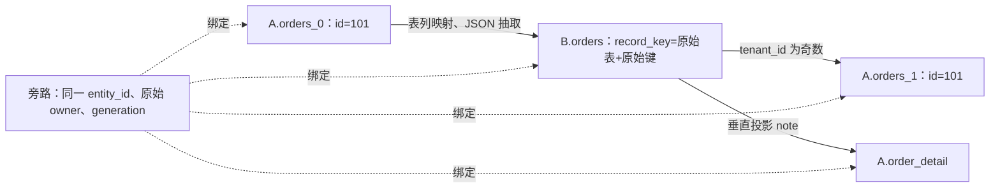

# 旁路身份映射：开发实现与操作

本分支在原 Go 映射程序中新增 `identity.mode: sidecar`。业务表不添加 `_sync_source / _sync_table / _sync_pk`，身份、删除历史、源镜像和恢复进度写入 `_pgcat_yaml` 元数据 schema。仍然需要 publication、逻辑复制槽及业务表 `REPLICA IDENTITY FULL`；这不是完全不需要数据库配置的方案。

本程序延续 [kingluo/pgcat](https://github.com/kingluo/pgcat) 的 origin 防环思路。本次新增代码在 `pgcat-yaml` 中，未修改上游 C 扩展；旁路模式使用 PostgreSQL 原生 `pgoutput`，不安装 `pgcat-pgxs`。默认不指定 identity 时仍运行旧的 columns 模式。

## 已保存的老版本

- 老分支：`master`。
- 基线提交：`e54a66dad0e568ecac55bd3dbdaf3b2d543b01c2`。
- 基线标签：`pgcat-columns-baseline-20261117`。
- 新分支：`codex/sidecar-identity-map`。
- 原 `output/pgcat-yaml-source/pgcat-yaml` 和 `output/pgcat-yaml-source.zip` 保持原样；新代码以根目录 `pgcat-yaml/` 为准。

`env.txt`、原始 `job-yaml/`、本机工具链和编译文件不进入提交。不要用 `git reset --hard` 回滚工作目录。需要并排查看老代码时，在工作区根目录执行：

```powershell
git worktree add --detach .\tmp\columns-baseline pgcat-columns-baseline-20261117
```

## 文件改动

| 文件 | 职责 |
|---|---|
| `config.go` | 两种 identity 模式；旁路 namespace、bootstrap、稳定 sink.id 校验 |
| `identity.go` | 逻辑实体身份、代次、事务身份消息与业务 WAL 配对 |
| `identity_store.go` | 旁路 DDL、唯一键登记、绑定/删除历史、outbox 恢复、目标归属检查 |
| `engine.go` | 从旁路身份提供 `__owner_*__` 和 `__entity_id__`，映射时不生成来源列 |
| `runtime.go` | 一致快照读绑定；历史身份随 checkpoint 保存；pgoutput messages；提交后回补源登记 |
| `store.go` | columns/sidecar 写入分派；保留旧 columns 写法 |
| `convert.go` / `main.go` | WMS YAML 转换增加旁路参数与显式目标业务键文件 |
| `identity_test.go` / `integration_test.go` / `identity_two_db_test.go` | 旁路单测、真实 WAL、独立两库、故障中断及旧模式回归 |
| `examples/sidecar/` | 完整无来源列示例；与原 demo 使用不同 schema、job、slot、origin |

## 身份与物理键

一个实体的 `entity_id` 由 namespace、最初来源节点/表/键和生成代次计算。它与物理表、当前分片、当前主键分离：



UPDATE 改主键或分片键时保留实体身份；DELETE 保留 tombstone；本地 INSERT 即使重用旧主键，也使用新的 WAL 代次，不能继承旧实体。初始本地数据的代次使用导出快照的 consistent LSN。相同事务重放生成相同身份。

`__owner_source__ / __owner_table__ / __owner_pk__` 是最初来源身份；`__entity_id__` 可用于配置转换表达式。它们不是业务表列。示例仍用原始表和键合成 `record_key`，业务主键删除后可以复用，但旁路实体代次不同。

旁路不能增加业务表唯一键的容量。N:1 中不同来源都使用 `id=101`，目标若只有 `PRIMARY KEY(id)`，必须先确定业务可用的复合键或合成键。系统对异源实体撞键报错并回滚，不静默覆盖，不自动改业务 ID。

## 元数据表与提交顺序

| 表 | 保存的内容 |
|---|---|
| `sidecar_version` | 元数据版本（当前 1） |
| `key_spec` | namespace + 节点 + 物理表对应的有序键定义；正反方向必须一致 |
| `row_binding` | 当前物理键 → 实体身份，alive 与该节点本地 WAL 版本 |
| `identity_history` | 绑定和 tombstone 历史，区分相同物理键的不同代次 |
| `identity_state` | 每个消费 job 在 checkpoint 时刻捕获的源身份 |
| `identity_outbox` | 目标事务已经提交、仍待回补源库旁路登记的事件 |
| 原 `row_state` / `checkpoint` | 完整源行镜像与消费进度；沿用旧表布局 |

运行时按下面顺序处理：

1. 读取完整源事务。源 UPDATE/DELETE 的身份从 checkpoint 对应的 `identity_state` 读取，不用“当前物理键的最新绑定”倒推历史身份。
2. 在目标同一事务中写业务表、目标绑定、源行镜像、历史身份、outbox、checkpoint，并设置 replication origin。
3. 每条实际目标业务 DML 后，在同一事务写 `pg_logical_emit_message(true, 'pgcat-yaml.identity.v1', ...)`。消息包含目标节点、实际键、DML 类型和实体身份。
4. 目标 COMMIT 后，将 outbox 幂等写入源库元数据，源库 COMMIT，再删除目标 outbox。
5. outbox 清空后才推进源 slot。进程在目标提交后退出时，checkpoint 防止重复业务 DML；源登记提交、目标 ack 前退出时，恢复会重复登记并幂等完成。

跨数据库事务没有全局原子提交。上述持久 outbox 是恢复协议；源库元数据暂时不可写时任务报错并保留 outbox，修复后用原 YAML `run`，不重新 init。旁路登记按每个节点自己的 LSN 比较，旧消费事件不能覆盖该节点较新的目标写入绑定。所有 metadata 表必须排除在业务 publication 外。

## 双向防环

旁路模式要求 `pgoutput` 的 `origin=any` 和 `messages=true`。反向消费者读取带 origin 的业务 WAL 和同事务身份消息，验证 table、键、DML 类型及 namespace/node 后更新镜像、身份和 checkpoint，跳过业务转发。不能直接过滤所有 remote origin，否则后续本地修改副本时会丢失原始身份或 TOAST 镜像。

陌生 namespace/node 的消息被忽略；本 job 的 remote-origin 业务 DML 缺少匹配身份消息会停止，避免把未知副本误认为本地新增。系统不会为转发事务再次发业务写入或身份消息，循环最终静止。该协议不是多主并发冲突解决器，仍须按实体切换单点写权并等待双向追平。

## YAML

```yaml
identity:
  mode: sidecar
  namespace: orders_sidecar_v1
  bootstrap: local
source:
  id: legacy
  # 其余 source 参数见 examples/sidecar/a-to-b.yaml
sink:
  id: new_app
  # 其余 sink 参数见完整样例
```

这段仅解释新增参数，不能单独执行。正反方向的 namespace 相同、source.id/sink.id 对调；job、slot、origin 分开。`source-key` 和相反方向指向该物理表的 `primary-keys` 必须是同一组、同一顺序、受实际唯一约束保护的非空业务键。

slot 和 replication origin 在 PostgreSQL 实例中全局命名；在同一实例创建另一套测试/生产作业时，也必须换用不同名称，不能仅换数据库名。删除测试数据库不会自动删除 replication origin。

- `bootstrap: local`：对一致快照中尚未登记的记录，明确认定为本节点最初产生的数据，创建身份。仅用于已确认归属的首次全量。
- `bootstrap: require-binding`：每条快照记录必须已有活跃旁路绑定；缺失或 tombstone 均拒绝。`snapshot: seed` 默认该值，避免把 A 已复制到 B 的记录登记成 B 原生数据。
- `snapshot: copy` 默认 local；有登记时沿用登记。`seed` 只初始化源镜像、身份和 checkpoint，不写业务目标。
- `adopt-unmarked-source` 在旁路模式仅允许显式接管“本节点、原始物理表、原始键”完全一致的未绑定旧业务记录；不能接管任意来源或已 tombstone 的其他代次。
- `require-existing` 和 `on-delete: patch-null` 继续约束垂直字段回写；它们不会把子表删除扩大成整条合表删除。

业务列没有 `_sync_*` 时，既有的 `include-all`、`columns`、函数、JSON patch、when 路由照常使用。历史上独立产生的父子行不会自动获得同一实体身份；已有垂直投影能继承同一身份，独立子表合入父实体需要先定义业务关联及迁移登记，不能猜测。

## 编译

在 `pgcat-yaml` 目录执行，Go 1.24+、psql18 已加入 PATH：

```powershell
go env -w GOPROXY=https://goproxy.cn,direct
go mod download
go test ./...
go vet ./...
New-Item -ItemType Directory -Force bin | Out-Null
go build -buildvcs=false -o bin/pgcat-yaml-sidecar.exe .
```

不设置 `PGCAT_TEST_DSN` 时真实数据库用例显示 SKIP。源码包包含脱敏 WMS fixture，不依赖原始生产配置。Linux 构建与 systemd 部署方式沿用 README，把 YAML 换成旁路版本，并确保源、目标连接都有对应 metadata 的写权限。

## 样例完整操作

以下使用独立 `pgcat_sidecar_a / pgcat_sidecar_b`，不会操作旧 `pgcat_demo_*`。初始化期间冻结两端样例业务写入；A 数据作为权威，B 初始为空。SQL 中仅业务字段，没有来源列。

```powershell
$env:PG_DSN = 'host=127.0.0.1 port=15432 dbname=mapping_poc user=testuser sslmode=disable'
$env:PGPASSWORD = [System.Net.NetworkCredential]::new('',(Read-Host '数据库密码' -AsSecureString)).Password
$env:PGCAT_A_DSN = $env:PG_DSN
$env:PGCAT_B_DSN = $env:PG_DSN
psql -X -v ON_ERROR_STOP=1 -d $env:PG_DSN -f examples/sidecar/schema.sql
psql -X -v ON_ERROR_STOP=1 -d $env:PG_DSN -f examples/sidecar/seed.sql
.\bin\pgcat-yaml-sidecar.exe check --config examples/sidecar/a-to-b.yaml
.\bin\pgcat-yaml-sidecar.exe check --config examples/sidecar/b-to-a.yaml
.\bin\pgcat-yaml-sidecar.exe init --config examples/sidecar/a-to-b.yaml
.\bin\pgcat-yaml-sidecar.exe init --config examples/sidecar/b-to-a.yaml
```

`schema.sql` 已有同名 schema 时失败，不会覆盖。`seed.sql` 插入 A.orders_0 的 101（Alice、tenant=2）和 A.orders_1 的 202（Bob、tenant=3）。A init 后 B.orders 有两条记录，outbound_id 的 9007199254740993 保持整数精度；B init(seed) 读取 B 的已有绑定，不回写 A。

两个终端各自设置上面的连接变量和密码，然后分别常驻运行：

```powershell
# 终端一
.\bin\pgcat-yaml-sidecar.exe run --config examples/sidecar/a-to-b.yaml
# 终端二
.\bin\pgcat-yaml-sidecar.exe run --config examples/sidecar/b-to-a.yaml
```

第三个终端设置 PG_DSN / PGPASSWORD 后执行：

```powershell
psql -X -v ON_ERROR_STOP=1 -d $env:PG_DSN -f examples/sidecar/verify.sql
psql -X -v ON_ERROR_STOP=1 -d $env:PG_DSN -f examples/sidecar/change-b.sql
# 等待两个消费者追平
psql -X -v ON_ERROR_STOP=1 -d $env:PG_DSN -f examples/sidecar/verify.sql
```

101 的 tenant 改成 3 后，从 A.orders_0 移至 A.orders_1；`param.customer.name` 为 Alice revised，customer.tier 与 keep 保留；A.order_detail 出现 note。旁路绑定的最初 owner 仍为 A.orders_0，entity_id 不变。

再按顺序验证，始终先确认该实体只由当前一端业务写入，且双方追平：

```sql
UPDATE pgcat_sidecar_a.order_detail SET note='detail local edit' WHERE order_id=101;
-- 追平后：B.orders.note 和 payload.note 更新。
DELETE FROM pgcat_sidecar_a.order_detail WHERE order_id=101;
-- 追平后：B.orders 仍存在，note 为 SQL NULL，payload.note 为 JSON null。
DELETE FROM pgcat_sidecar_b.orders WHERE order_id=101;
-- 追平后：A.orders_1 的 101 删除；202 不受影响。
```

旁路查询见 `examples/sidecar/verify.sql`。用相同 YAML `run` 可续传；不要通过再次 init 清理进度。`--once` 仅处理一个解码批次，人工演示时需要反复运行两端直到追平。

## 从 WMS 配置转换

columns 模式原命令保持有效。sidecar 模式必须提供每张目标表实际已存在的唯一键：

```powershell
.\bin\pgcat-yaml-sidecar.exe convert-wms `
  --input '..\job-yaml\mysql-shards-to-postgres18-wms-fix.yaml' `
  --output '.\wms-sidecar.yaml' --identity-mode sidecar `
  --namespace wms-production-v1 --sink-id wms_new_pg `
  --target-keys '.\wms-target-keys.yaml'
```

`--target-keys` 是 `schema.table: [实际唯一键列...]` 的 YAML 映射，必须覆盖全部目标表。不要把 `_sync_*` 作为键。转换器不会推断生产 DDL，也不会复制连接凭证；现有输入是 MySQL CDC/Flink 配置，本程序的 source 必须连接 PostgreSQL 镜像表。多源 `id` 重复的目标需要业务上已有可用的合成键或复合键，否则旁路模式拒绝撞键。转换结果仍须对真实 DDL 执行 check；此命令不会部署到生产。

## 老 columns 作业如何切换

不能只改 `identity.mode` 继续旧 checkpoint：配置 hash 校验会拒绝。代码保留旧模式，数据库两种模式不能对同一批业务数据并发写入。

迁移顺序：停止业务写入 → 旧双向作业追平并停止 → 备份数据与旧 metadata/进度 → 明确每条记录的最初归属、物理键及垂直关联 → 采用新 namespace/job/slot 验证重建或显式导入旁路绑定 → A copy、B require-binding seed → 验证后恢复单点业务写权。当前未提供自动把所有旧 `_sync_*` 列转换成旁路绑定的在线迁移命令；不要把混有历史副本的数据整批 bootstrap 为本地原生。

新源码保持旧 row_state/checkpoint 表结构。切回老代码只能安全恢复旧 columns 作业及其原数据/配置；已无来源列的新业务表不能直接交给旧模式。Git 回滚代码不等于回滚数据库身份历史。

## 边界和恢复

- 源支持 PG16+、FULL 身份的普通表、完整 publication 列及受唯一约束保护的非空标量键；不支持 TRUNCATE、行过滤、列过滤、生成列、分区根等原有受限情况。
- 目标键必须有真实有效非部分唯一索引/约束。触发器不能静默改变配置业务键或抑制删除；检测到时事务回滚。会额外改动被发布业务表的触发器/外部复制器不在身份消息协议内，反向消费会拒绝缺失消息的 DML。
- 不能独立恢复业务数据与 metadata/slot：它们必须使用一致备份与明确恢复点。metadata 丢失、人工复用旧主键但未排空 CDC、历史绑定过期时，应停写对账重建，不能靠最新物理键猜历史来源。
- 旁路绑定和删除历史会增长；当前不自动 GC。规划存储，并在确认所有相关消费/恢复窗口后单独设计清理，不能只删除 tombstone。
- 单条身份消息上限 64 KiB（包含原始键、实际键和节点/表名）；超限时目标事务回滚，不生成反向无法读取的消息。
- bootstrap/reseed 需要冻结写入并排空相关源消费/outbox。异步捕获本地 DML 的登记存在时间差，不能把未追平的当前绑定当作任意时刻全局一致快照。
- 一个 job 的全部目标 DML 在同一目标数据库事务中。跨库 fanout 和多主冲突仲裁保持未实现。

## 验证

```powershell
$env:PGCAT_TEST_DSN = $env:PG_DSN
go test -v -count=1 -timeout 45m ./...
Remove-Item Env:PGCAT_TEST_DSN
```

真实 WAL 测试仅创建随机命名的临时 schema/publication/slot/origin 和对应 namespace metadata，结束后清理，不修改现有 demo 或生产表。测试覆盖 columns 回归、sidecar copy/seed、JSON 大整数与 TOAST、水平路由迁移、垂直回写/删除、防环静止、重启、目标约束回滚、目标提交后重试，以及旁路代次、主键变更、outbox ack 中断与旧绑定覆盖防护。

2026-11-17：上述完整用例在本机隔离 PostgreSQL 18.7 实例通过。两个独立数据库的测试也已通过，覆盖拒绝无绑定 seed、双向迁移、源登记提交后中断/重启、循环静止、缺失身份消息时拒绝推进进度。该用例需显式设置 `PGCAT_TEST_ADMIN_DSN` 指向有 CREATEDB 权限的可丢弃测试实例，会创建并最终删除两个随机命名的测试数据库：

```powershell
# 仅对隔离测试实例执行，不指向生产库。
$env:PGCAT_TEST_ADMIN_DSN = 'host=127.0.0.1 port=55432 dbname=postgres user=pgcat_local sslmode=disable'
go test -v -count=1 -run TestSidecarTwoDatabaseWAL -timeout 5m
Remove-Item Env:PGCAT_TEST_ADMIN_DSN
```

远程授权 PG18.6 测试的首轮通过隧道运行，因 SQL 往返延迟在 7 分钟期限超时，未完成整套验证，不能视为远程验收通过。PG16 实机、跨服务器断网与灾备恢复组合仍需上线前补测。没有上传代码到跳板机。
