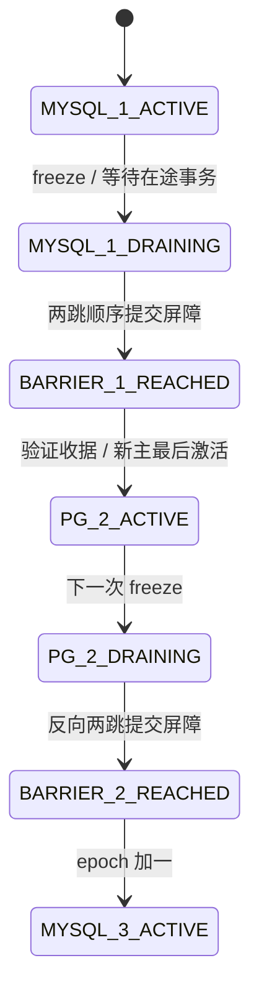
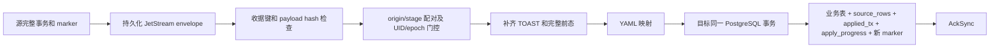

# 组件开发设计与实现索引

本实现复用 pg_flo 原有捕获、NATS 和 worker，对 replay-v2 增加严格事务路径；普通 pgflo/v1 映射作业继续使用原路径。两种路径不可混用：v2 信封交给普通 Sink 会报错。

| 组件 | 实现 | 关键职责 |
| --- | --- | --- |
| YAML loader | pkg/jobconfig/config.go | 严格字段校验；要求 stream、保留 origin、关闭 DDL、NATS max-age=0；绑定捕获地址/表集合，排除密码轮换 |
| 转换与路由 | pkg/mapping/config.go、engine.go | 水平条件、垂直多路投影、来源合成键、冲突/删除策略；计算 before/after 差异，路由退出删除旧键 |
| UDF 注册 | pkg/mapping/extensions.go、cmd/transforms.go | 编译扩展注入每个 Engine，包括 preview 和 ReplaySink；不替换内置函数；YAML 直接引用 |
| 协议上下文 | pkg/replay/config.go、pkg/utils/cdc_message.go | 事务携带 marker/root/writer/stage/uid/epoch/barrier；PG origin 单独携带，不能从当前主写状态推断事件来源 |
| 复制器 | pkg/replicator/base_replicator.go、table_handling.go | 同事务抽出唯一 tx_context，发布整笔 envelope；按 schema.table 保存主键；业务表必须 PK + REPLICA IDENTITY FULL |
| 初始化/恢复检查 | cmd/replay.go | slot 导出快照建立前态；丢槽、错 publication、丢失 offset 或删除 JetStream 历史拒绝继续；基线与 orphan slot 不自动重建 |
| 消息消费 | pkg/worker/worker.go | v2 单条 Fetch、MaxAckPending=1、无限次可重试；错误 NAK 后停止；目标提交后 AckSync；避免失败事务之后的记录先应用 |
| 原子落地 | pkg/sinks/replay.go | 通道事务锁、收据先行校验、epoch 行锁、前态补齐、映射、业务 SQL、收据/进度/标记统一提交 |
| JSON 局部回写 | pkg/sinks/replay.go applyProjection | 目标行 FOR UPDATE；只改声明列和 JSON 对象路径；目标不存在、路径穿过标量会失败；兼用于普通 PostgresSink |
| 写权/CAS | pkg/replay/schema.sql、cmd/replay.go | begin_write / freeze_writer / emit_barrier / activate_writer；激活要求屏障收据和相邻 epoch；切换历史支持幂等重试 |
| 四跳协调 | examples/uid-replay/Switch-Uid.ps1 | 冻结顺序、验收完整路径、分发协调器收据证明、新主最后激活；部分完成可重试 |
| 样例业务聚合 | ../../../cdc-replay-v2/sql/*fixture.sql | 四分量汇总；反向触发器更新四张已存在原表；按 UID 找回历史主键，禁止未定义的聚合删除 |

## 事务顺序与状态

应用调用 begin_write 时取得 ownership 的共享行锁，并插入同事务的只追加标记。freeze 更新同一行，需要等此前应用事务提交，因此屏障位于这些事务之后。目标在 DRAINING 阶段仍接收屏障之前的旧代事务；提交该屏障的 cutover_step 后拒绝旧代新事务。写权门禁依据 marker 中记录的 epoch，不把积压旧事件改标成当前 epoch。

`source_tx_key=SHA256(transactionID)`，其中 PG 捕获的 transactionID 包含 xid 与 commit LSN；收据还包含 channel 和 source-stream-id。校验哈希使用原始 envelope，排除观测时间 EmittedAt。相同位置、不同载荷报错；已提交重复先按哈希确认，然后可跨 epoch 返回成功，不再重复写业务或 marker。提交失败不留任何收据或新前态。

回声要同时匹配预期 origin、writer、stage。它只更新源行前态、收据与进度，既不调用映射也不写下一跳 marker。保留回声的前态有助于下一次切回后继续读取正确数据；仅用 origin=none 会看不到这部分状态变化，因此 replay-v2 强制关闭这一过滤。

## 合表与反向身份

source 身份策略使用 `(_pgflo_source,_pgflo_source_table,_pgflo_source_pk)` 三元组，主键 JSON 保留精确数值。已有原始来源标记不会因新捕获节点覆盖；自动生成的来源列禁止被 columns/json-patches 重写。

反向 route 通过 `target-from: lineage` 和 allowed-targets 决定原表，`__owner_pk_0` 等虚拟字段恢复原复合键成员。before/after 的来源三元组不得变化；没有身份、未在白名单或空目标键都拒绝。主键拆解使用 json.Number，不经 float64。

mapped 身份策略适合库存 `(kind,id)` 或 `(uid,wh_id,upc)` 等已定义的业务键。使用者应证明该键不会让不同来源错误共享一行；系统不推断任意表的删除归属。示例 kind 字面量明确区分 stock 与 reserved 的相同 id，反向 SQL 用 uid 定位各原表，保留 `1,1,3,4`。

## 元数据和升级

共享 `cdc_meta` 表结构兼容现有事务 Java adapter；pgflo_meta 只保存本实现的配置绑定、快照基线、源前态和切换历史。业务数据与状态保存在同一个目标数据库。source_rows 使用 channel + 源全名 + 精确 JSON PK，UPDATE/DELETE 的 TOAST 字段由已提交前态补齐，缺少可证明的完整字段时停止。

Replay 配置指纹包含映射版本、route、origin、stage 策略、源地址/范围、stream ID，密码不参与。变更函数代码的语义必须人工更新 mapping.version，按新通道与一致基线部署；目前没有对 Go 函数机器码做自动版本判定。

多节点切换依赖受信任协调器和应用不能绕过的写门禁。局部 SQL CAS 不是跨数据库共识；恢复流程在无法证明屏障到达时保持冻结，不自动选新主。元数据、消息保留、业务事务范围与故障恢复均应作为上线契约。
